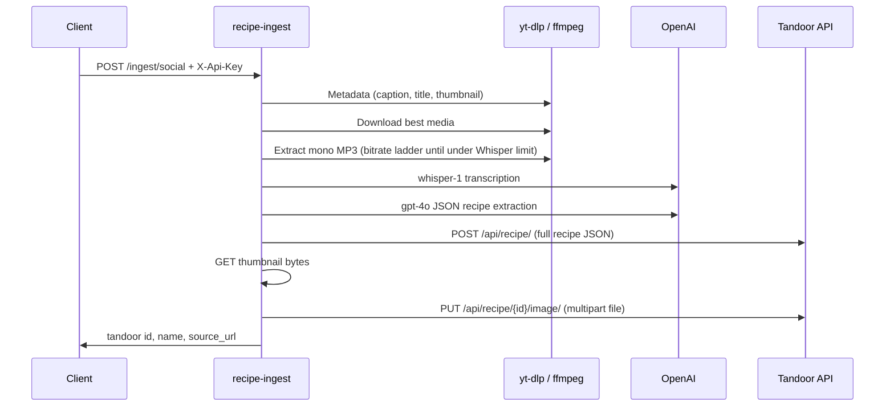

# Recipe Ingest

[](https://github.com/TylerConlee/recipe-ingest/actions/workflows/ci.yml)
[](https://codecov.io/gh/TylerConlee/recipe-ingest)

A small **FastAPI** service that turns cooking content from **TikTok** and **Instagram Reels** into structured recipes in **[Tandoor Recipes](https://docs.tandoor.dev/)**. It downloads media with **yt-dlp**, prepares audio for **OpenAI Whisper**, asks **GPT-4o** to extract a Tandoor-shaped recipe (steps with nested ingredients, times, keywords, and metadata) from the caption plus transcript, then **creates the recipe via the Tandoor REST API** and uploads the video thumbnail as the cover image.

There is **no published container image** today. The intended workflow is to **build the image yourself** (on your media server or in CI) and run it from your own stack, or push to a private registry if you want reuse across hosts.

## Goals

- **Single HTTP trigger**: POST a social URL (and optional title hint); get a Tandoor recipe back.
- **Richer than captions alone**: Whisper fills in spoken quantities and steps when the post text is thin.
- **Tandoor-native output**: One `POST /api/recipe/` payload with steps, per-step ingredients (`food` / `unit` / `amount` / `note`), working and waiting times, servings, description, `source_url`, and keywords—then **`PUT /api/recipe/{id}/image/`** with the downloaded thumbnail (multipart), because Tandoor’s image action uses multipart parsing.
- **Simple to gate**: Shared secret via `X-Api-Key` so only your automation or reverse proxy can call the service.

## How it works (flow)



1. **Authenticate** the request with `INGEST_API_KEY` (header `X-Api-Key`).
2. **Classify** the URL as TikTok, Instagram, or unknown (metadata path is the same).
3. **Fetch metadata** with yt-dlp (caption, title, thumbnail URL) without downloading the full file first.
4. **Download** the best combined media format yt-dlp can resolve for that URL.
5. **Transcode** audio with ffmpeg to a small mono MP3 (16 kHz, stepped bitrates) so the file stays under Whisper’s ~25 MB cap; delete the original download after a passing tier.
6. **Transcribe** with `whisper-1` (if the file is still too large, transcription is skipped and extraction relies more on the caption).
7. **Extract structured JSON** with `gpt-4o`: title, description (truncated to Tandoor’s 512-char limit), servings, prep/cook/passive minutes, cuisine and keywords, steps with nested ingredients (including section headers when needed), and `source_url`.
8. **Normalize** legacy flat `ingredients` + string `steps` from older prompts into Tandoor steps when the model returns that shape.
9. **Tandoor**: `POST /api/recipe/` → optional thumbnail download → `PUT /api/recipe/{id}/image/` with `files={"image": ...}`.
10. **Cleanup** temporary audio on disk.

Legacy alias: **`POST /ingest/tiktok`** behaves the same as **`POST /ingest/social`**.

## Requirements

- **Tandoor Recipes** reachable from the container (same Docker network or LAN URL). Create a **long-lived API token** in Tandoor and use it as `TANDOOR_API_TOKEN` (`Authorization: Bearer …`).
- **OpenAI API** access (`OPENAI_API_KEY`) for Whisper and GPT-4o.
- **ffmpeg** inside the image (already installed in the provided `Dockerfile`).
- For some Instagram/TikTok URLs, a **cookie file** may be required; mount it and set `YTDLP_COOKIE_FILE` (see below).

## Configuration (environment variables)

| Variable | Required | Purpose |
|----------|----------|---------|
| `OPENAI_API_KEY` | Yes | OpenAI API key. |
| `TANDOOR_URL` | Yes | Base URL for Tandoor (no trailing slash), e.g. `https://recipes.home.arpa` or `http://tandoor:8080`. |
| `TANDOOR_API_TOKEN` | Yes | Tandoor API bearer token. |
| `INGEST_API_KEY` | Yes | Secret the client must send as `X-Api-Key`. |
| `YTDLP_COOKIE_FILE` | No | Path inside the container to a Netscape-format cookies file (e.g. `/cookies/cookies.txt`). |
| `YTDLP_FFMPEG_LOCATION` | No | Directory containing `ffmpeg` and `ffprobe` if not on `PATH` (the default image already has them on `PATH`). |

The application **fails fast at import time** if any required variable is missing.

## API

**Endpoint:** `POST /ingest/social`  
**Headers:** `X-Api-Key: <INGEST_API_KEY>`  
**Body (JSON):**

```json
{
  "url": "https://www.tiktok.com/@user/video/1234567890",
  "manual_title": "Optional override hint for the recipe title"
}
```

**Success response** (shape from the handler): `status`, `platform`, `tandoor_id`, `tandoor_name`, `source_url`.

Example:

```bash
curl -sS -X POST "http://localhost:8000/ingest/social" \
  -H "Content-Type: application/json" \
  -H "X-Api-Key: $INGEST_API_KEY" \
  -d '{"url":"https://www.instagram.com/reel/XXXXXXXX/"}'
```

## Deployment

### Build and run locally (no registry)

From the repository root:

```bash
docker build -t recipe-ingest:local .
docker run --rm -p 8000:8000 \
  --env-file .env \
  recipe-ingest:local
```

Use a **secrets mechanism** your orchestrator supports (Docker Compose `secrets`, Kubernetes secrets, etc.) instead of committing `.env` to git.

### Optional: publish your own image

Because this repo does not ship a pre-built image, pick one of:

- **Build on the host** that runs your stack (simplest for a single media server).
- **Private registry** (Docker Hub, GitHub Container Registry, etc.): `docker tag` / `docker push` after `docker build` in CI so other machines can `docker pull`.

### Docker Compose

Use the checked-in **`docker-compose.yml`**. It builds `recipe-ingest:local`, publishes port **`${RECIPE_INGEST_PORT:-8000}`**, and passes required variables from your environment or a project **`.env`** file (Compose reads `.env` for `${…}` substitution automatically).

```bash
docker compose up -d --build
```

Uncomment the **`networks`** blocks in `docker-compose.yml` when Tandoor lives on another Docker network so this service can resolve `TANDOOR_URL` (for example `http://recipes:80` on that network). If Tandoor is only reachable via your host or a public URL, set `TANDOOR_URL` accordingly instead.

### Cookies and platform quirks

TikTok and Instagram change behavior often. If downloads fail with auth or geo errors, export a browser cookie file in Netscape format, mount it read-only, and set `YTDLP_COOKIE_FILE`. Do **not** bake cookie files into the image; mount them at runtime.

### Operational notes

- **Resource usage**: Downloads and ffmpeg are CPU/disk heavy; Whisper and GPT add latency and OpenAI cost per request.
- **Expose carefully**: Put the service behind your home reverse proxy with TLS and IP allowlisting or network policies; the only auth modeled here is the static API key.
- **Image hygiene**: The `Dockerfile` uses `COPY . .`; **`.dockerignore`** excludes `.env`, `cookies.txt`, VCS metadata, and other noise so those files are not copied into the image layer.

## Development

```bash
python3 -m venv .venv
source .venv/bin/activate  # Windows: .venv\Scripts\activate
pip install -r requirements.txt
export OPENAI_API_KEY=... TANDOOR_URL=... TANDOOR_API_TOKEN=... INGEST_API_KEY=...
uvicorn app.main:app --reload --host 0.0.0.0 --port 8000
```

Requires **ffmpeg** on the host for local runs (same as the container).

### Tests and coverage

```bash
python3 -m venv .venv
source .venv/bin/activate
pip install -r requirements-dev.txt
pytest tests/ --cov=app --cov-report=term-missing --cov-fail-under=80
```

CI (GitHub Actions) runs the same command on **Python 3.12** with placeholder environment variables so imports succeed; external services are not contacted because tests use mocks.

Coverage from the latest workflow run is uploaded to **[Codecov](https://codecov.io/gh/TylerConlee/recipe-ingest)**; the badge above reflects the default branch after you [add this repository to Codecov](https://docs.codecov.com/docs/quick-start) (free for public projects). For **private** repositories, create an upload token in Codecov and add it as the `CODECOV_TOKEN` repository secret so uploads succeed.

## License

Add a `LICENSE` file if you intend to open-source this repository; none is present in the tree at the time of writing.
