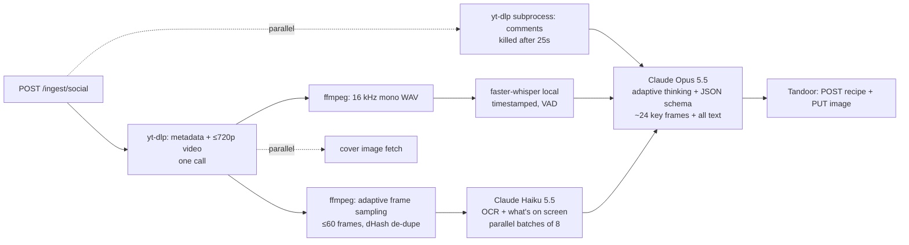

# Recipe Ingest

[](https://github.com/TylerConlee/recipe-ingest/actions/workflows/ci.yml)
[](https://codecov.io/gh/TylerConlee/recipe-ingest)

A small **FastAPI** service that turns cooking videos from **TikTok**, **Instagram Reels** and **YouTube Shorts** into structured recipes in **[Tandoor Recipes](https://docs.tandoor.dev/)**.

It pulls every signal a short-form recipe hides in: the caption, the creator's own comments (where amounts often live), popular viewer comments, a timestamped speech transcript, **on-screen text overlays and visible ingredients read from sampled frames**, and the frames themselves. **Claude** reconciles all of it into one Tandoor recipe with per-step ingredients, then the service creates it via the Tandoor REST API and uploads the cover image.

Each push to **`main`** or **`master`** (after tests pass) builds and pushes an image to **GitHub Container Registry** (`ghcr.io`).

```text
ghcr.io/tylerconlee/recipe-ingest:latest
```

Also tagged with the commit **SHA** (`sha-<short>`); git tags matching **`v*`** add semver tags.

## How it works



| Stage | Model / tool | Why |
|---|---|---|
| Speech → text | **faster-whisper** (`large-v3-turbo`, int8, CPU) | Claude has no audio input. Runs locally: no per-call cost, segment timestamps, VAD skips music. `TRANSCRIBER=openai` falls back to the Whisper API. |
| Frame reading | **Claude Haiku 5.5** | Reads *every* sampled frame for a fraction of a cent: verbatim overlay text ("2 tbsp gochujang"), visible ingredients, the action, and a flag for frames that carry recipe info. |
| Recipe extraction | **Claude Opus 5.5**, adaptive thinking, `effort=high` | Sees the most informative frames directly plus caption, comments, timestamped transcript and the full frame timeline; reconciles conflicts with an explicit precedence order; tags every ingredient with where its amount came from. Output is enforced by a JSON schema (structured outputs), so no parse failures. |

Thoroughness features:

- **On-screen text** — many TikTok recipes only show amounts as overlays; these were invisible to the old caption + audio pipeline.
- **Music-only videos** — no speech? Frames + caption + comments still produce a recipe.
- **Creator comments** — every comment by the uploader is included, plus the top-liked viewer comments.
- **Provenance** — each ingredient records `source` (caption, speech, on-screen text, comment, visual estimate, inferred). Visual estimates are marked "amount estimated from video" in the Tandoor note.
- **Notes step** — equipment, creator tips and "double-check this" items land in a final *Notes* step.
- **Not-a-recipe detection** — returns `422` instead of creating junk in Tandoor.

Performance changes vs. v1:

- One yt-dlp extraction instead of two, capped at 720p instead of `best`.
- Transcription, frame sampling + OCR, comment fetching and cover download all run concurrently.
- Work happens in a per-request temp dir (v1 wrote downloads into the app directory and could leak them on failure).
- Optional **background mode** + **push notification**, so the iOS Shortcut returns instantly.
- Duplicate submissions of the same URL within 10 minutes are de-duplicated.
- Every response includes per-stage `timings` and `stats`.

### Cost

With the defaults, a typical 60-second video costs about **$0.10–0.20** in Claude API usage (Opus: roughly 20–25k input tokens, mostly images, plus a few thousand output tokens; Haiku frame reading is under a cent). Claude **Max/Ultra** plans include monthly Claude API credits: link a Console organization under *claude.ai → Settings → Billing → API credits* and create the API key in that organization.

## Requirements

- **Tandoor Recipes** reachable from the container, plus a long-lived Tandoor API token.
- **Anthropic API key** (`ANTHROPIC_API_KEY`).
- **ffmpeg** (in the provided image).
- ~2 GB RAM for the local Whisper model; mount a volume at `/models` so it downloads once.
- For some URLs, a yt-dlp **cookie file** (`YTDLP_COOKIE_FILE`).

## Configuration (environment variables)

| Variable | Required | Default | Purpose |
|----------|----------|---------|---------|
| `ANTHROPIC_API_KEY` | Yes | | Claude API key. |
| `TANDOOR_URL` | Yes | | Tandoor base URL, e.g. `http://tandoor:8080`. |
| `TANDOOR_API_TOKEN` | Yes | | Tandoor API bearer token. |
| `INGEST_API_KEY` | Yes | | Secret clients send as `X-Api-Key`. Must be ≥16 chars and not a placeholder (`openssl rand -hex 32`). |
| `CLAUDE_EXTRACT_MODEL` | No | `claude-opus-5-5` | Model for the final extraction. `claude-sonnet-5-5` halves cost. |
| `CLAUDE_EXTRACT_EFFORT` | No | `high` | `low`/`medium`/`high`/`xhigh`/`max`. |
| `CLAUDE_VISION_MODEL` | No | `claude-haiku-5-5` | Model for per-frame reading. |
| `FRAME_OCR` | No | `true` | Disable the Haiku frame pass (Opus still sees evenly spaced frames). |
| `FETCH_COMMENTS` | No | `true` | Fetch creator + top comments. |
| `TRANSCRIBER` | No | `local` | `local` (faster-whisper), `openai` (needs `OPENAI_API_KEY`), or `none`. |
| `WHISPER_MODEL` | No | `large-v3-turbo` | Any faster-whisper model name (`small` is ~3x faster, less accurate). |
| `WHISPER_THREADS` | No | `4` | CPU threads for Whisper. Keep this below your core count. |
| `WHISPER_MODEL_DIR` | No | `/models` (image) | Where models are cached. |
| `NOTIFY_URL` | No | | ntfy-style URL; a plain-text POST is sent when a job finishes or fails. |
| `OPENAI_API_KEY` | No | | Only for `TRANSCRIBER=openai`. |
| `YTDLP_COOKIE_FILE` | No | | Netscape cookie file path inside the container. |
| `YTDLP_FFMPEG_LOCATION` | No | | Directory containing `ffmpeg`/`ffprobe` if not on `PATH`. |
| `TANDOOR_OAUTH_TOKEN_VIA_QUERY` | No | `false` | Send the token as `access_token` query param (for proxies that strip `Authorization`). |

The application **fails fast at startup** with a message naming any missing or invalid variable.

Use the **long-lived access token** from Tandoor (**Settings → API**), not a session cookie. A duplicate `Bearer` prefix is stripped automatically.

### Tandoor returns 403 “Authentication credentials were not provided”

1. **`TANDOOR_API_TOKEN` is empty in the container** — check with `docker compose exec recipe-ingest env | grep TANDOOR`.
2. **Reverse proxy strips `Authorization`** — forward the header, or set `TANDOOR_OAUTH_TOKEN_VIA_QUERY=1`.
3. **Redirects** — ensure `TANDOOR_URL` is the canonical URL your proxy expects.

## API

### `POST /ingest/social` (alias `POST /ingest/tiktok`)

Headers: `X-Api-Key: <INGEST_API_KEY>`

```json
{
  "url": "https://www.tiktok.com/@user/video/1234567890",
  "manual_title": "Optional: force this recipe title",
  "background": false
}
```

- `background: false` (default): waits and returns `200` with `status`, `platform`, `tandoor_id`, `tandoor_name`, `tandoor_link`, `source_url`, `uncertainties`, `timings`, `stats`.
- `background: true`: returns `202 {"status": "queued", "job_id": "..."}` immediately; poll `GET /jobs/{job_id}` or rely on `NOTIFY_URL`.
- `422` when the video contains no recipe. Re-posting the same URL within 10 minutes returns the existing result or job.

### `GET /jobs/{job_id}`

Headers: `X-Api-Key`. Returns `status` (`queued`/`running`/`done`/`error`/`not_a_recipe`), `result`, `error`.

### `GET /healthz`

Unauthenticated; returns configured models and transcriber.

```bash
curl -sS -X POST "http://localhost:8000/ingest/social" \
  -H "Content-Type: application/json" \
  -H "X-Api-Key: $INGEST_API_KEY" \
  -d '{"url":"https://www.tiktok.com/@user/video/123","background":true}'
```

### iOS Shortcut

Use **Get Contents of URL** → POST JSON `{"url": <Shortcut Input>, "background": true}` with the `X-Api-Key` header. The Shortcut finishes instantly; the ntfy notification (tap opens the Tandoor recipe) arrives when the import is done.

## Deployment

### Pre-built image (GHCR)

```bash
docker pull ghcr.io/tylerconlee/recipe-ingest:latest
docker run --rm -p 8000:8000 --env-file .env ghcr.io/tylerconlee/recipe-ingest:latest
```

Use a **secrets mechanism** your orchestrator supports (Docker Compose `secrets`, Kubernetes secrets, etc.) instead of committing `.env` to git.

### Build and run locally

From the repository root:

```bash
docker build -t recipe-ingest:local .
docker run --rm -p 8000:8000 \
  --env-file .env \
  recipe-ingest:local
```

### Docker Compose

Use the checked-in **`docker-compose.yml`**. By default it **builds** `recipe-ingest:local` and publishes **`${RECIPE_INGEST_PORT:-8000}`**. To use the CI image instead of building, set `image:` to `ghcr.io/tylerconlee/recipe-ingest:latest` (see comments in the file) and remove or keep `build:` as you prefer.

```bash
docker compose up -d --build
```

Uncomment the **`networks`** blocks in `docker-compose.yml` when Tandoor lives on another Docker network so this service can resolve `TANDOOR_URL` (for example `http://recipes:80` on that network). If Tandoor is only reachable via your host or a public URL, set `TANDOOR_URL` accordingly instead.

### Cookies and platform quirks

TikTok and Instagram change behavior often. If downloads fail with auth or geo errors, export a browser cookie file in Netscape format, mount it read-only, and set `YTDLP_COOKIE_FILE`. Do **not** bake cookie files into the image; mount them at runtime.

### Operational notes

- **Resource usage**: Local Whisper is CPU-heavy. At most two imports run concurrently, and `WHISPER_THREADS` caps cores per import.
- **Expose carefully**: Put the service behind your home reverse proxy with TLS and IP allowlisting or network policies; the only auth modeled here is the static API key.
- **Image hygiene**: The `Dockerfile` uses `COPY . .`; **`.dockerignore`** excludes `.env`, `cookies.txt`, VCS metadata, and other noise so those files are not copied into the image layer.

## Development

```bash
python3 -m venv .venv
source .venv/bin/activate  # Windows: .venv\Scripts\activate
pip install -r requirements.txt
export ANTHROPIC_API_KEY=... TANDOOR_URL=... TANDOOR_API_TOKEN=... INGEST_API_KEY=...
uvicorn app.main:app --reload --host 0.0.0.0 --port 8000
```

Requires **ffmpeg** on the host for local runs (same as the container).

### Tests and coverage

```bash
python3 -m venv .venv
source .venv/bin/activate
pip install -r requirements-dev.txt
pytest tests/ --cov=app --cov-report=term-missing --cov-fail-under=80
```

CI (GitHub Actions) runs the same command on **Python 3.12** with placeholder environment variables so imports succeed; external services are not contacted because tests use mocks.

Coverage from the latest workflow run is uploaded to **[Codecov](https://codecov.io/gh/TylerConlee/recipe-ingest)**; the badge above reflects the default branch after you [add this repository to Codecov](https://docs.codecov.com/docs/quick-start) (free for public projects). For **private** repositories, create an upload token in Codecov and add it as the `CODECOV_TOKEN` repository secret so uploads succeed.

## License

Add a `LICENSE` file if you intend to open-source this repository; none is present in the tree at the time of writing.
